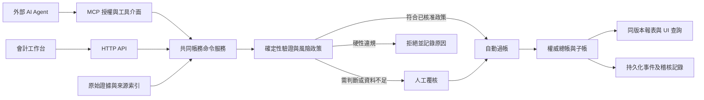

# Agentic Accounting System Roadmap

文件日期：2026-10-18。文件性質：Draft，供產品、會計、工程及設計負責人評審。

本 Roadmap 的市場順序與外部 Agent 模式來自已確認的 [SRC-0005](../01-inputs/2026-10-18-roadmap-request.md)。功能範圍、時程、驗收數值與技術方案均為建議，未構成版本承諾。需求目前狀態只維護於[需求池](../04-requirement-pool/requirement-pool.md)；核准後才建立 `06-versions/v<major>.<minor>/scope.md`。

## 1. 產品方向與首發邊界

產品要讓外部 AI Agent 經 MCP 完成記帳準備、查詢、對帳建議及獲授權的低風險過帳。系統本身負責帳務規則、權限、證據、審批、記錄與報表。會計人員在同一個工作台處理例外、覆核與關帳。

Observed，使用者已確認：

1. 市場依序為中國大陸、香港、澳洲、北美。
2. 外部 AI Agent 經 MCP 接入做帳。
3. 部分低風險科目可自動過帳，其餘由人覆核。

To confirm，以下作為估算假設：

| 維度 | 首發建議 | 確認時點 |
| --- | --- | --- |
| 客群 | 中國大陸服務型小企業，先一個法人、一套正式帳、CNY 本位幣 | G0，由產品及當地會計共同確認 |
| 會計制度 | 先判定企業適用制度，再選定一套首發規則；不能由「小企業」名稱推定適用《小企業會計準則》 | G0，須有會計負責人 |
| 稅務身分 | 明確一般納稅人或小規模納稅人、稅種、申報週期與生效日；首發只承諾選定組合 | G0 |
| Agent 客戶端 | 選兩個實際使用的 MCP 客戶端做互通驗收，模型可由使用者選擇 | v0.6 前 |
| 部署與資料流 | 中國大陸首發的儲存、備份、外部模型接收資料範圍及供應商安排 | 真實資料進入試點前 |
| 職責分工 | 記帳人、覆核人、業務付款批准人、系統管理員分開授權；小公司可由外部會計覆核 | G0 |

Not covered，v1.0 不包含庫存成本、製造、工資薪酬計算、集團合併、銀行轉帳執行或直接稅務申報。服務型企業需要的簡單收入遞延、預付、應計及固定資產屬本次路線。若首發客戶依賴排除功能，須調整客群或擴大範圍重新估算，不能用普通分錄假裝已支援完整業務。

## 2. 現況與優先順序

來源：[SRC-0006 程式基線](../01-inputs/2026-10-18-roadmap-code-baseline.md)、[本次測試紀錄](../07-reviews/2026-10-18-roadmap-baseline-verification.md)。

| 現況，Observed | 對 Roadmap 的影響，Inferred |
| --- | --- |
| Monolith UI 與 MCP 操作兩套不同帳務資料 | 先統一帳務命令與查詢，否則外部 Agent 的結果不能可靠呈現在預設 UI |
| 已有持久化、版本衝突、冪等、人工覆核、登入與憑證撤銷 | 保留並擴展現有能力，避免另建第三套帳務流程 |
| 部分營運命令直接過帳，人工分錄另有覆核 | 把過帳政策套用到 API、MCP、排程、匯入及子帳所有入口 |
| Agent 佇列仍含固定示例任務；事件派送是記憶體佇列 | 建立真實提案、工作狀態、持久化事件及故障恢復 |
| 稅務示例、固定期間/餘額、JSON 金額與前端報表計算仍存在 | 清除正式資料路徑中的示例假設，統一金額、期間和報表來源 |
| 關帳 MFA、多公司授權及正式運維尚未完成 | 放入上線門檻，不能以畫面可操作代替驗證 |
| 52 項後端、17 項前端現有測試通過 | 作為回歸起點，另補真實業務案例與錯誤路徑 |

第一優先是讓同一筆經濟事件在不同入口得到相同會計結果。第二優先是人能看懂、查證及更正。自動化只在這兩者已成立的範圍內擴大。

## 3. 目標架構

以上為建議架構，並非現有完成狀態。沿用 Python/FastAPI、SQLAlchemy、React/TypeScript 及 Monolith UI。初期採有清楚模組邊界的單體系統，帳務原子性比拆成微服務更優先。

共同資料模型至少含 Entity、Book、Period、Account、Counterparty、Document、Journal/Line、Settlement/Allocation、BankStatement/Match、TaxRecord、ApprovalDecision、PolicyVersion、AgentRun、CommandReceipt、AuditEvent、ReportSnapshot。所有寫入與讀取都有公司與帳套授權。初期單公司也要有此邊界。

日記帳、子帳變更、決策紀錄、命令回執及 outbox event 在同一資料庫交易提交。查詢可以分頁或非同步建立，但須標示帳本版本；關帳與正式匯出必須對到同一凍結版本。舊報表與舊入口逐步改用共同服務。

對外 MCP 授權及工具版本需按實作時選定的官方協定版本驗證，不能只看 SDK 名稱。公開遠端接入規劃 OAuth 授權、資源與 audience 驗證；受控服務憑證另定清楚支援範圍。[MCP Authorization](https://modelcontextprotocol.io/specification/2026-07-28/basic/authorization)

## 4. 版本總覽

以下均為建議版本名稱，不修改現有 package 版本或建立 release。週數自該階段開始計，依賴驗收通過才進入下一階段。

| 階段 | 主要使用者成果 | 建議工期 | 進入下一階段的核心證據 |
| --- | --- | --- | --- |
| G0 | 知道首發替哪類公司完成哪一套帳 | 1–2 週 | 會計制度、稅務身分、基準案例、角色及風險邊界獲確認 |
| v0.5 | UI 與 MCP 看同一套帳，金額與權限一致 | 3–5 週 | 共同服務、遷移核對、併發與隔離測試 |
| v0.6 | 外部 Agent 可做帳；合格低風險交易可受控過帳 | 3–4 週 | 兩個 MCP 客戶端互通、政策反例、人工覆核與停用演練 |
| v0.7 | 日常應收應付與銀行交易可完整處理 | 3–5 週 | 部分付款、退款、紅字/貸項、重複單據及未達帳項案例 |
| v0.8 | 中國大陸首發範圍可完成一個月結 | 3–5 週 | 子帳核對、調整、報表、當地規則、鎖帳及重開全流程 |
| v0.9 | 在受控真實資料與真實使用者下驗證 | 6–8 週，至少涵蓋兩個連續月結 | 會計雙軌核對、復原演練、UX 與安全評審 |
| v1.0 | 中國大陸首發範圍正式營運 | 1–2 週發佈準備 | 正式環境驗證、責任人、回復方案與支援流程 |
| v1.1 | 香港本地規則與繁體中文工作流程 | 6–10 週起 | 當地制度適用性及獨立基準案例通過 |
| v1.2 | 澳洲本地規則與 AUD 工作流程 | 6–10 週起 | GST/BAS 底稿及法人/個人業務分流通過 |
| v1.3 | 北美第一個明確法域 | 8–12 週起 | 先選美國或加拿大及州/省範圍，再驗收當地規則 |
| v1.4 | 北美另一國家或下一個已選法域 | 6–10 週起 | 另建規則包與試點，不能直接複製 v1.3 |

中國大陸 v1.0 約 20–31 週，屬資源假設下的規劃範圍。假設有兩名後端/帳務工程師、一名 MCP/AI 工程師、一名前端工程師，設計與 QA 各約半名投入，另有具當地經驗的會計負責人及運維支援。這是角色配置建議，不代表現有人手。首兩個 sprint 量到速度後重估；真實月結等待、法域評審及外部介面准入可能延長日曆時間。

## 5. 各次升級如何完成

### G0：先定義什麼叫做對

對應 REQ-0001，後續全階段依賴。

1. 選定一家代表性服務企業與兩個連續期間，確認會計制度、稅務身分、帳套、憑證格式及科目表。另準備會計人員核定的期初餘額與子帳明細。
2. 建立至少 30 個基準情境，含一般交易、稅務、例外與跨月更正。每例寫明事實、原始證據、預期分錄、子帳、稅務記錄及報表影響。
3. 定義三種結果：可自動過帳、須人工覆核、必須拒絕。輸入不完整與違反硬性規則不能靠主管點擊通過。
4. 畫出單據、分錄、結算、對帳及期間狀態。確定計帳覆核與付款授權的差別。
5. 用現有 Monolith 風格做任務流程原型，讓記帳人及覆核人走一次「證據 → 分錄 → 對帳 → 月結」。

交付：來源清單、決策草案、角色矩陣、案例集、狀態圖及原型。驗收：會計負責人逐例核定預期結果；產品負責人確認首發邊界。未知稅務身分或無覆核人時，保留草稿/沙盒模式。

### v0.5：統一帳務核心與公司邊界

對應 REQ-0002～0005；依賴 G0。

1. 以現有 ledger/posting 與 Monolith command 能力為起點，定義一套權威命令服務。先完成一條來源單據到報表的垂直流程，再遷移其餘入口。
2. 統一 Decimal 金額與 API decimal-string 契約、幣別精度、捨入規則、會計日期、時區及期間。四位內部精度不能直接當成所有幣別或稅表顯示規則。
3. 公司設定、科目表、期間、期初餘額及往來對象進入共同模型。保留原科目 ID 對照；同一代碼在不同帳套不能被視為同一科目。
4. 補公司/帳套授權、受限查詢、MFA 與人員職責；帳務政策管理需財務授權，系統管理員沒有默認帳務批准權。
5. 建立隔離 demo 與正式公司檔的入門流程，移除正式報表對固定餘額、示例任務及歷史樣本的依賴。
6. 遷移採備份、dry run、逐科目及逐子帳核對、附件 hash/批准人核對、凍結舊寫入、切換與恢復演練。禁止兩套帳同時成為正式寫入來源；不能將 USD 示例資料改標成 CNY 公司。

UI/UX：頂部固定顯示公司、帳套、期間、幣別、帳本版本及正式/示例標記。保存衝突保留使用者輸入，顯示伺服器已接受哪些內容。

驗收：同一案例經 UI 與 MCP 得到相同結果；同一命令重送與並行執行只產生一次有效業務結果；跨公司讀寫全部拒絕；遷移核對無未解差額；所有正式報表取自權威服務。

### v0.6：外部 MCP Agent 與受控自動過帳

對應 REQ-0006～0010；依賴 v0.5。這是第一個可用的 Agent 記帳縱向切片，可在限定模板內工作。

1. MCP 提供受限公司資料查詢、單據登記、建立草稿、驗證提案、提交、查詢結果及待覆核事項。工具名稱及 schema 作為版本化契約，錯誤含原因碼、欄位與下一步。
2. 每次提案綁定 company/book、來源文件 hash、原始欄位定位、分錄、政策版本、Agent 身分、外部 run ID 與冪等鍵。模型/提示版本能提供則保存；無法取得時標示未知，不能偽造已知。
3. 實作[低風險政策](accounting-control-matrix.md#低風險自動過帳政策)。只允許核准的科目組合、交易模板、供應商及金額範圍。外部 Agent 不能變更政策、提升自己的權限或把 `approved=true` 當授權。
4. 自動政策先在沙盒與 shadow mode 比較人工答案，再按公司及模板逐項啟用。初始可用模板建議是可驗證銀行手續費、已批准合約的固定費用、已批准時間表的週期認列；涉及稅務判斷則轉人工。
5. 人工覆核支援退回補件、修改後重新送審、拒絕及過帳。修改金額、科目、日期、來源或政策後，原批准失效。
6. 真實 AgentRun 與持久化 outbox 取代固定示例任務；加入至少一次派送、消費端冪等、退避、死信、重啟恢復、取消及狀態查詢。外部服務逾時不等於帳務未提交。

UI/UX：任務首頁區分「待人覆核」「政策自動過帳」「執行失敗」。三欄覆核工作台同時顯示原文、擬議分錄、規則與影響。政策頁顯示允許範圍、單筆/累計上限、最近變更及停用。

驗收：至少兩個指定客戶端完成提案與結果查詢；測過越權、重放、拆單繞額度、惡意單據指令、撤銷憑證與併發；政策批准與自動執行有獨立稽核紀錄。高風險提案全部進人工；硬性違規全部拒絕。無有效政策時預設人工覆核。

中國大陸電子憑證要求含必要經辦、審核及審批程序。預先核准政策能否滿足特定交易的審簽制度，需會計與內控責任人核定；未核定模板只能維持人工流程。這不改變使用者選定的受控自動過帳方向，而是其啟用條件。[財會〔2020〕6 號](https://www.mof.gov.cn/gkml/caizhengwengao/202001wg/wg202004/202007/t20200707_3545393.htm)

### v0.7：中國大陸日常帳務閉環

對應 REQ-0011、0012，並建立 REQ-0014 的交易稅務資料；依賴 v0.6。

1. 應收：開立/認列、部分收款、跨發票分配、預收、退款、貸項及壞帳覆核。應收明細必須與控制科目核對。
2. 應付：原始單據、重複檢查、認列覆核、付款批准、部分付款、預付、退款與貸項。付款批准不代表費用尚未認列；UI 分開顯示兩種狀態。
3. 先完成可重現的銀行 CSV 匯入與預覽，再做一個經選定銀行/供應商授權的唯讀接入。支援一對多、多對一、手續費、撤銷匹配與合法未達帳項。匯入游標、重複檔及漏頁須可核對。
4. 發票/電子憑證保留原檔、結構化欄位、來源、驗證結果及更正鏈。OCR 內容不能取代真實性及會計憑證檢查；第三方查驗不可用時顯示未查驗。
5. 每筆稅務資訊保存稅碼、生效日、計稅依據、稅額及可抵扣判定依據，避免從總帳餘額乘示例比例產生申報欄位。

UI/UX：銀行左側原始流水、右側候選帳務、中間顯示差額及理由。批次操作先列明筆數、總金額、會新增哪些分錄及例外。保留鍵盤操作、篩選與返回原工作位置。

驗收：收款/付款不重複產生收入/費用；部分付款餘額與帳齡正確；關聯退款/貸項可追溯；一個銀行交易不能重複認列或被多次消耗；當期未達項可帶到次期清除；自動過帳僅覆蓋已通過新情境驗證的模板。

### v0.8：中國大陸月結、報表與規則包

對應 REQ-0013～0015；依賴 v0.7 及 G0 制度決策。

1. 固定資產取得與登記互相連結，處理投入使用日、折舊、殘值、處置與減值判斷。預付、應計及簡單遞延收入以可追溯時間表認列。
2. 為所選制度建立可版本化科目/報表映射及交易規則。稅務身分、規則生效期間及適用條件需明確；會計處理與所得稅調整分開。
3. 建立試算表、明細底稿、當地適用的財務報表及稅務覆核工作表。每個數字可追到總帳行、來源與批准紀錄。展示為「工作表/草稿」的內容不自稱完成申報。
4. 關帳計算自動檢查與人工判斷分開。未達帳項有證據、原因與覆核時可進入核對表；未解錯誤、未過帳必要調整及子帳差異會阻擋關帳。
5. MFA 簽核同一版本報表及資料快照。重開要求原因、授權與影響預覽，後續期間需重新核對。更正採沖銷及重記，保留原始分錄。

UI/UX：關帳頁按阻擋事項、可接受時點差異、待會計判斷、已完成證據排序。任何阻擋項可直接跳到修正位置。顯示當期、累計與比較期間的定義，不混用月/季/年度示例。

驗收：完成兩個期間的基準案例，確認期初到期末銜接、子帳/總帳/底稿一致、報表及現金勾稽；關帳與最後一筆過帳競態不破壞快照；未授權重開失敗。當地會計簽認首發規則包及限制。

### v0.9：受控試點與營運驗證

對應 REQ-0016、0017；依賴 v0.8。預備安全與可觀測性工作從 G0 開始，並非到此才開始做。

1. 建議招募 3–5 家同類企業，至少含記帳及覆核兩種角色。取得使用資料的必要授權，保留原系統或人工帳作平行核對。
2. 至少兩個連續實際月結。分層抽查全部自動政策、高金額、跨期、稅務及被修正交易；重大錯誤須全量追查受影響政策。
3. 驗證正式選定資料庫、備份與還原、附件恢復、部署回復、憑證撤銷、公司隔離與事件重送。還原後重新核對帳本版本、回執與事件，避免重複過帳。
4. 進行獨立安全評審、WCAG 2.2 AA 核心流程檢查及任務式可用性測試。沒有真實使用者資料前，不聲稱節省多少工時。
5. 建立監控：未解帳務差異、政策異常、佇列延遲、事件失敗、登入異常、未授權工具呼叫及最近成功備份。

驗收建議：零未解重大帳務錯誤；關鍵情境成功率達 90% 以上且沒有不可恢復財務誤操作；至少兩次月結能由參與者自行完成；試點修正率按政策與交易金額分開報告。樣本不足不代表可擴大自動權限。

### v1.0：中國大陸首發營運

對應 REQ-0018；依賴 v0.9 及正式 owner approval。

1. 發佈支援矩陣，寫明企業/制度/納稅人類型、交易類型、報表、語言、Agent 客戶端與資料庫。
2. 完成上線清單、值班與事件處理責任、客戶匯入/匯出、操作手冊及復原演練。記錄部署版本、環境、驗證人與日期。
3. 每個客戶逐項開啟已核准政策，保留人工模式及公司級停用。未完成配置時不自行選擇寬鬆預設。
4. 上線後觀察 2–4 週，追蹤錯誤、覆核耗時、支持負擔及政策停用原因，再決定可否擴大範圍。

驗收：正式環境中的上傳/提案/覆核或自動過帳/對帳/關帳/匯出完整流程通過，必要恢復演練完成。依[狀態與 gate 規則](../00-rules/status-and-gates.md)記錄發佈證據後，需求才可轉入 released。

### v1.1：香港

對應 REQ-0019、0023；依賴中國大陸 v1.0 的共用核心及獨立香港評審。

1. 確認適用 SME-FRF/SME-FRS、HKFRS for Private Entities 或 HKFRS 的條件；中文 UI 語言不是會計框架選擇。
2. 建立 HKD、繁體中文/英文、當地科目與報表、董事往來及利得稅覆核工作表。地域來源與優惠適用屬有證據的人工作業。
3. 複用帳務核心；另建香港交易及報表 golden set，不沿用大陸稅務計算。至少一個月結試點與當地會計簽認。
4. 加入事務所多公司工作列及清楚的公司切換。跨幣交易僅在匯率來源、結算及期末重估另行驗收後開放；本位幣單一不等於不能保存原交易幣別。

### v1.2：澳洲

對應 REQ-0020；依賴 v1.1 階段退出及獨立 AU 評審。

確認企業類型、報告框架、GST 登記與核算方式，建立 AUD、GST 明細、BAS 覆核底稿、公私用途分攤、公司董事往來與 sole trader 業主提款的分流。GST 可抵扣、企業所得稅扣除及資本化分開判定。銀行及會計資料遷移各做一條驗收路徑；申報/支付整合另立範圍與准入要求。

### v1.3、v1.4：北美按法域展開

對應 REQ-0021、0022；依賴 v1.2 階段退出。

G0-NA 先決定美國或加拿大優先、實體類型及州/省。若選美國，獨立確認報告基礎、州別 sales/use tax 與資訊申報範圍；若選加拿大，獨立確認報告框架及 GST/HST/PST 適用性。兩國以不同規則包、工作表、專業覆核與試點驗收。這些是研究清單，未承諾全面稅務支援。

每一個新市場採相同步驟：確認適用制度 → 註冊官方來源與生效日 → 編寫會計基準例 → 實作規則與語言 → 本地月結試點 → 正式發佈。市場順序已確定，跨市場功能與工期仍須逐次評審。

## 6. 每次升級的共同完成條件

1. 需求範圍與例外先寫清楚，會計人員給預期答案；新增高風險判斷需記錄來源。
2. 同一條使用者流程一起交付資料模型、命令、MCP、UI、錯誤處理、稽核與測試。
3. 跑基準案例、權限負向測試、重送/並發/部分失敗測試及必要人工任務測試。
4. 對 migration、policy、模型/client、rule pack 變更分別記版本；更換外部 Agent 也要跑接入與代表案例。
5. Pilot → limited rollout → 擴大使用，保留停用與回復；已過帳交易需按會計更正，不能因部署回復刪帳。
6. 產品、會計、工程、設計/QA 分別提供範圍、帳務、實作、任務驗收證據；owner 批准正式階段變更。

## 7. 衡量成功

以下都是待校準目標，沒有聲稱目前已達標。

| 指標 | 定義與初始 gate |
| --- | --- |
| 會計正確性 | 基準案例在分錄、子帳、稅務與報表的預期結果全通過；未解控制差額為零；零未解重大錯誤 |
| 自動過帳品質 | 已審核自動分錄中，需更正金額/科目/日期/稅碼的比率；按政策、筆數、金額及嚴重性分層，任何重大錯誤立即停用受影響政策 |
| 自動覆蓋率 | 自動處理筆數 ÷ 當期全部可記帳交易；另報 eligible subset 的比率，禁止只縮小分母美化成績 |
| 覆核效率 | 同類交易的人工作業時間中位數及 P90，相對試點前基線；等待補件時間另計 |
| 月結效率 | 期間結束至覆核簽核的時間，分開外部文件延遲及系統處理時間 |
| 可追溯性 | 過帳交易均有來源或具理由的調整依據、授權決策、版本及時間；樣本連結解析成功率 100% |
| UX | 每輪 5–8 名代表使用者的關鍵任務成功率目標 ≥90%；金融錯誤及公司/期間誤判單列，不能藏在平均值 |
| 韌性 | 重送與重啟不重複過帳；備份還原能核對帳務、附件及未完成工作 |
| 服務效能 | v0.9 使用約 100,000 條分錄行、10 個同時操作會話建立測試基線；常用查詢 P95 <2 秒為初始目標，外部 Agent 推理時間另報 |
| AI 成本 | 只計量本系統可觀察的工具呼叫、服務運算及已提供的模型用量；外部 Agent 未提供成本時顯示未知 |

自動過帳統計需報樣本量及不確定性。即使 1,000 筆抽樣零錯誤，也不能宣稱風險為零；稀有高風險情境必須用定向反例驗證。

## 8. 風險、責任與下一個 sprint

| 風險 | 主要責任角色，姓名待確認 | 處理方式 |
| --- | --- | --- |
| 多入口規則不一致 | 帳務後端負責人 | 共用命令、權限、政策與 conformance tests |
| 地區規則或稅務優惠誤用 | 當地會計/稅務負責人 | 明確適用性、生效日、來源及 signed golden set |
| Agent 拆單、提權或受文件指令影響 | MCP/AI 工程師與安全評審人 | 伺服器硬限制、累計上限、不可由 Agent 修改政策、攻擊測試 |
| 外部 Agent/模型取得不適當資料 | 產品、部署與資料治理負責人 | 接入前確認資料流、最少資料、儲存/保留/供應商安排；正式使用前完成適用要求評審 |
| 會計看不到自動化出了什麼問題 | 產品設計與會計負責人 | 政策抽查佇列、可追溯證據、例外分類及停用入口 |
| 遷移或恢復重複記帳 | 後端與運維負責人 | dry run、凍結切換、回執保留、逐帳核對與演練 |
| 時程受未定人手或法域範圍影響 | 產品 owner | 每兩個 sprint 按完成量重估，版本門檻優先於日期 |

首個兩週 sprint 的具體順序：

| 時段 | 行動 | 可評審交付物 |
| --- | --- | --- |
| 第 1–2 天 | 選首發企業/制度/稅務身分、指定會計與產品 owner | G0 決策草案、支援/排除矩陣 |
| 第 3–4 天 | 比對現有兩套帳務入口，列出共用模型與遷移對照 | command inventory、科目/狀態 mapping、風險清單 |
| 第 5 天 | 定義低風險政策及 30 個案例骨架 | 允許/覆核/拒絕矩陣、案例與預期結果模板 |
| 第 6–7 天 | 做 MCP 提案到覆核/政策決策的任務原型 | 工具契約草案、三欄覆核及政策頁原型 |
| 第 8–9 天 | 會計核定案例；工程驗證一筆交易的共同服務設計 | 設計驗證與實作切分，不提前改寫正式資料 |
| 第 10 天 | 評審 v0.5 與 v0.6 的明確 scope、驗收及資源 | 可核准的需求包與版本 scope 草案 |

## 9. 文件與來源

- [會計控制矩陣](accounting-control-matrix.md)：跨模組不變條件、自動過帳政策及具體測試案例。
- [UI/UX 流程藍圖](ux-workflow-blueprint.md)：資訊架構、頁面任務、狀態、文案與使用者驗收。
- [需求池](../04-requirement-pool/requirement-pool.md)：唯一需求狀態來源，含責任人待確認欄位、依賴及暫定版本。
- [SRC-0005](../01-inputs/2026-10-18-roadmap-request.md)：使用者方向。
- [SRC-0006](../01-inputs/2026-10-18-roadmap-code-baseline.md)：實作基線與限制。
- [SRC-0007 官方來源研究](../01-inputs/2026-10-18-roadmap-primary-sources.md)：外部規則與設計依據；每個市場正式開發前仍需重新核對。

Observed 僅指有可檢查證據的現況。Inferred 指由現況提出的判斷。本文件未標為 Observed 的未來方案均是 To confirm。Not covered 項目不能據此對客戶承諾。
