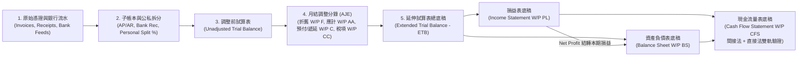

# Deep-Dive Architecture: Agentic Accounting System for SMEs, OPCs & Sole Proprietors

## 1. Architectural Positioning: Autonomous Accounting Team for SMEs, OPCs & Sole Traders

Small and Medium Enterprises (**SMEs 中小企**), One-Person Companies (**OPCs 一人公司**, such as Australian Single-Director Pty Ltd, US Single-Member LLC / S-Corp, HK/SG Private Limited, PRC 一人有限公司), and Sole Proprietors (**個體戶 / 獨資經營者 / Sole Traders**) do not need heavyweight multi-tier group consolidation early on. Instead, their highest-value pain points are:

1. **Automated Bookkeeping & Mixed Business/Personal Expense Apportionment (公私混用拆分與股東/業主往來管理)**:
   - Founders and sole traders frequently pay for mixed-use items (home office internet, mobile, motor vehicles, travel, SaaS subscriptions) or accidentally swipe a corporate card for personal expenses.
   - The **Expense & Bank Rec Agent** automatically splits mixed transactions into **Business Deductible %** (claiming proportional input VAT/GST) and **Personal / Non-Deductible %**, routing the personal portion to **Owner's Drawings (`3200 業主提款` for Sole Proprietors)** or **Director's Loan / Shareholder Current Account (`2190 董事/股東往來` for OPCs)** while guarding against statutory commingling penalties.
2. **Automated Standalone Three Financial Statements & Working Papers (單體三大報表底稿自動編製)**:
   - Producing audit-ready **Working Papers (`底稿`)**—specifically the **Extended Trial Balance (`ETB 試算表與調整工作底稿`)**, **Lead Schedules (`W/P A` to `W/P EQ` 明細底稿)**, **Income Statement (`損益表`)**, **Balance Sheet (`資產負債表`)**, and **Cash Flow Statement (`現金流量表` - Indirect & Direct Methods)**—without manual Excel copy-pasting or broken formulas.
3. **Cross-Border & Local Tax Compliance (IFRS / US GAAP / SME Standards across CN, HK, SG, AU, NA, EU)**:
   - Navigating regional VAT/GST exemptions, withholding taxes, and corporate tax reliefs tailored to small businesses and solo founders.

## 2. SME, OPC & Sole Proprietor Accounting Matrix Across 6 Regions

| Region | Target Legal Structures | Applicable Accounting Standard | SME / OPC / Sole Trader Tax & Statutory Guardrails |
| :--- | :--- | :--- | :--- |
| **Mainland China (`CN`)** | 一人有限公司 (`OPC_LIMITED`), 個體工商戶 (`SOLE_PROPRIETOR`), 中小企業 (`SME_CORP`) | 《小企業會計準則》 / `PRC_CAS` / `IFRS` | 1. **新《公司法》第23條（一人公司財產混同連帶責任）**：系統強制監控 `股東往來` 借方餘額與公私帳混同風險，並產出年度 CPA 審計所需三大報表底稿。 2. **小規模納稅人免稅額監控**：自動追蹤季度銷售額 RMB 30 萬以下免徵增值稅門檻，以及小型微利企業（應納稅所得額 $\le$ 300 萬）`5%` 實際企業所得稅率。 3. **金稅四期數電票（20碼）**進項抵扣驗證與現金流量表**直接法**正表 + **間接法**補充資料雙軌產出。 |
| **Hong Kong (`HK`)** | 一人私人有限公司 (`OPC_LIMITED`), 獨資東主 (`SOLE_PROPRIETOR`), 中小企 (`SME_CORP`) | `SME-FRS` (中小企財務報告準則) / `HKFRS` | 1. **兩級制利得稅**：首 HKD 200 萬應評稅利潤稅率 `8.25%`（法團）或 `7.5%`（獨資/合夥），其後 `16.5%` / `15%`。 2. **地域來源原則（Territorial Source）**：分錄層級標記 `ONSHORE` vs. `OFFSHORE` 離岸收入底稿。 3. **《公司條例》（第622章）第380條董事往來披露**：自動生成 `W/P DD` 董事往來帳戶期初、最高借方餘額及期末餘額底稿以供核數師（Auditor）查核。 |
| **Singapore (`SG`)** | Exempt Private Company / OPC (`OPC_LIMITED`), Sole Proprietorship (`SOLE_PROPRIETOR`) | `SFRS for Small Entities` / `SFRS(I)` | 1. **Audit Exemption Check**：自動檢核是否符合「小公司審計豁免」（營收 $\le$ SGD 1,000 萬、總資產 $\le$ SGD 1,000 萬、員工 $\le$ 50 人中之兩項）。 2. **新創免稅計畫（SUTE）與部分免稅（PTE）**：首 SGD 10 萬應課稅收入 `75%` 免稅，次 SGD 10 萬 `50%` 免稅。 3. **IRAS 9% GST 強制登記雷達**：滾動追蹤過去 12 個月營業額是否逼近 SGD 100 萬門檻；支援 **InvoiceNow (Peppol)**。 |
| **Australia (`AU`)** | Single-Director Pty Ltd (`OPC_LIMITED`), Sole Trader (`SOLE_PROPRIETOR`), SME Pty Ltd | `AASB` (Simplified Disclosure / Tier 2) | 1. **ATO Division 7A (ITAA 1936) 董事借款攔截**：若一人公司（Pty Ltd）之 `Director's Loan Account (W/P E)` 於期末呈現借方餘額（股東向公司拿錢未還），系統自動發出警告，提醒於報稅截止日前償還或簽署合規 7 年期 Division 7A 貸款協議，否則視為未扣抵股利（Unfranked Dividend）課稅。 2. **PSI (Personal Services Income) 個人勞務所得檢測**：針對一人顧問公司檢核 80% 單一客戶門檻與 Results Test。 3. **Small Business Entity ($10M Turnover)**：$20,000 固定資產即時沖銷（Instant Asset Write-Off）、25% Base Rate Entity 公司稅率、BAS (`G1/1A/1B/W1/W2`) 與 **47% No-ABN PAYG Withholding**。 |
| **North America (`US` / `CA`)** | **US**: Single-Member LLC (Schedule C), S-Corp, C-Corp **CA**: Sole Prop, CCPC (`OPC_LIMITED`) | `US_GAAP` (or Tax Basis) / Canada `ASPE` & `IFRS` | 1. **US Entity Structure Routing**：針對 Single-Member LLC 自動映射 IRS **Schedule C** 費用分類与 Home Office / Vehicle 比例分攤；針對 S-Corp 監控股東合理薪資（Reasonable W-2 Compensation）與股東分配（Distribution）比例。 2. **US Multi-State Sales & Use Tax + 1099-NEC**：Economic Nexus 追蹤、未稅採購自動提列 Consumer Use Tax、缺失 W-9 自動代扣 `24%` Backup Withholding。 3. **Canada CCPC**：首 CAD 50 萬主動營業所得享 `9%` 聯邦小型企業扣除額（SBD），支援 GST/HST/PST。 |
| **Europe (`EU` / `UK`)** | Single-Member Ltd / GmbH / SASU (`OPC_LIMITED`), Sole Trader (`SOLE_PROPRIETOR`) | `IFRS` / UK `FRS 102 (Section 1A)` / `FRS 105 (Micro-entities)` | 1. **UK Section 455 CTA 2010 Director's Loan Charge**：若一人公司董事往來帳出現透支（Overdrawn）且未於財年結束後 9 個月內清償，自動試算 `33.75%` s.455 稅項提列。 2. **EU SME VAT Exemption & Reverse Charge**：追蹤歐盟跨境 B2B 反向徵收（Intra-Community Reverse Charge）、VIES 稅號檢查與 SAF-T 匯出。 |

## 3. Standalone Three Financial Statements & Working Paper Engine (`三大報表底稿引擎`)

In professional accounting practice, financial statements are never generated directly from unverified raw entries. They are the final output of a structured **Working Paper Pack (`底稿包`)** governed by the **Maker-Checker-Auditor Agent Team**:

### 3.1 Extended Trial Balance Working Paper (`ETB 延伸試算表總底稿`)
Every account row in the `ETB` tracks 10 deterministic columns:
1. `Opening Balance` (期初餘額)
2. `Period Operational Debit / Credit` (本期日常營運發生額 — 來自銀行對帳、應收應付發票、費用報銷)
3. `Unadjusted Ending Debit / Credit` (調整前期末試算表餘額 — 強制驗證 $\sum \text{DR} = \sum \text{CR}$)
4. `Adjusting Journal Entries (AJE Debit / Credit)` (期末調整分錄 — 由 `Close & Working Paper Agent` 提列折舊、應計費用、預付攤銷、遞延收入、所得稅準備與公私混用重分類)
5. `Adjusted Trial Balance (ATB Debit / Credit)` (調整後試算表 — 強制驗證 $\sum \text{ATB DR} = \sum \text{ATB CR}$)
6. `Working Paper Reference (W/P Ref)` (對應明細底稿索引，如 `W/P A` 貨幣資金、`W/P B` 應收帳款、`W/P DD` 股東往來、`W/P F` 固定資產)
7. `Statement Destination` (自動分流至 `INCOME_STATEMENT` 或 `BALANCE_SHEET`)

### 3.2 Lead Schedules (`明細底稿 W/P A ~ W/P EQ`)
- **`W/P A` (Cash & Bank Reconciliation Schedule)**: Reconciles ending GL cash balance to external bank statement closing balance (`Unreconciled Variance == 0.0000`).
- **`W/P B` (Accounts Receivable & Aging Schedule)**: Summarizes open customer invoices by aging buckets (`0–30`, `31–60`, `61–90`, `90+` days) and Expected Credit Loss (`ECL`) provision.
- **`W/P C` (Prepayments & Input VAT/GST Schedule)**: Tracks prepaid SaaS/rent amortization and reconciles recoverable input tax to BAS `1B` / GST `F5` / Golden Tax IV verified credits.
- **`W/P E / W/P DD` (Owner's Drawings & Director's Loan Schedule)**: Tracks every founder cash advance, personal expense apportionment, and repayment, automatically flagging **PRC Company Law Art. 23**, **AU Division 7A**, or **UK s.455** risks when overdrawn (`Debit > 0`).
- **`W/P F` (Fixed Assets & Depreciation Roll-Forward Schedule)**: Reconciles `Opening Cost + Additions (CapEx) - Disposals = Ending Cost` and `Opening Accum Dep + Period Depreciation AJE = Ending Accum Dep`.
- **`W/P AA` (Accounts Payable & Accrued Expenses Schedule)**: Reconciles open vendor bills and month-end accruals.
- **`W/P CC` (Statutory Taxes Payable Schedule)**: Reconciles Output VAT/GST, PAYG/1099 Withholding, and Corporate Income Tax (`CIT`) provision.
- **`W/P EQ` (Equity & Retained Earnings Roll-Forward Schedule)**: Proves `Opening Equity + Capital Contributions - Drawings/Dividends + Current Period Net Profit == Ending Equity`.

### 3.3 Dual-Method Cash Flow Statement Working Paper (`W/P CFS`)
SMEs and OPCs across jurisdictions face different cash flow reporting requirements (e.g., IFRS IAS 7 and US GAAP ASC 230 predominantly use the **Indirect Method**, whereas Mainland China PRC CAS / 《小企業會計準則》 mandates the **Direct Method** on the primary statement). Our `StandaloneWorkingPaperEngine` computes **both methods simultaneously** and verifies the mathematical proof:
$$\text{Opening Cash (`W/P A`)} + \Delta \text{Operating Cash} + \Delta \text{Investing Cash} + \Delta \text{Financing Cash} \equiv \text{Ending Cash on Balance Sheet (`W/P A`)}$$

## 4. Stateless Streamable HTTP MCP + Event-Driven Agent Team

Following the [MCP Streamable HTTP Specification (2026-07-28)](https://modelcontextprotocol.io/specification/2026-07-28/basic/transports) and [`modelcontextprotocol/python-sdk`](https://github.com/modelcontextprotocol/python-sdk) (`stateless_http=True`), external AI Agents and the built-in **Event-Driven Orchestrator** collaborate across four core SME/OPC roles:

| Agent Role | Key MCP Tools & Prompts | Core Working Paper Responsibility |
| :--- | :--- | :--- |
| **`Bookkeeper & Expense Agent` (`MAKER_BOOKKEEPER`)** | `propose_three_way_match_bill`, `propose_expense_with_personal_split`, `propose_bank_reconciliation` | Parses invoices/receipts, splits mixed personal/business expenses (`business_use_pct`), matches bank feeds, and prepares `W/P A`, `W/P B`, `W/P AA`, and `W/P DD`. |
| **`Close & Working Paper Agent` (`MAKER_CLOSE_WP`)** | `propose_adjusting_workpaper_entry`, `generate_three_statements_working_paper`, Prompt `sme-opc-month-end-workpaper-sop` | Calculates depreciation (`W/P F`), prepayments/deferrals (`W/P C`), tax provisions (`W/P CC`), and compiles the full `ETB` + 3-Statement Working Paper Pack. |
| **`Controller Reviewer Agent` (`CHECKER_CONTROLLER`)** | `review_and_approve_proposal`, `simulate_tax_and_journal_impact` | Enforces Maker $\neq$ Checker SoD, verifies `ETB` cross-footing, checks OPC Director's Loan compliance, and auto-approves routine entries within materiality limits. |
| **`External / Tax CPA` (`HUMAN_CPA`)** | TypeScript Working Paper Dashboard & `cpa-signoff` API | Reviews escalated items (`AWAITING_CPA`), inspects `W/P Ref` schedules, signs off on the 3-Statement Working Paper Pack, and locks the fiscal period. |
