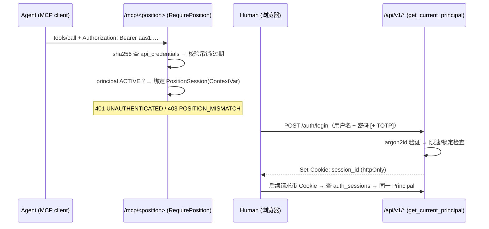

# 认证、授权与管理后台设计方案（Auth & Governance Design Proposal）

> 状态：**设计提案（已部分实施）** · 日期：2026-10-17
> 实施记录（英文）：[Authentication implementation and local setup](auth-implementation.md)。P0 与 P1 的认证基础已实现；MFA、完整治理 UI 与后续阶段仍未完成。下文保留原设计，当前行为以实施记录为准。
> 范围：AI Agent 的 MCP 接入认证、人类用户登录、REST API 鉴权对齐、账号与 Agent 活动管理后台
> 关联代码：`backend/app/mcp_roles.py`、`backend/app/mcp_server.py`、`backend/app/core/positions.py`、`backend/app/core/sod_guard.py`、`backend/app/main.py`、`backend/app/core/db.py`

---

## 1. 背景与目标

系统计划让多个 AI Agent 通过 MCP（Model Context Protocol）接入，**每个 Agent 拥有独立账号，权限等于其所属会计岗位的职责**；同时人类用户（Founder、外部 CPA）需要登录前端完成复核与签核。本方案回答四个问题：

1. Agent 和人类如何登录与验证？
2. 权限如何与会计岗位（`Position`）绑定？
3. REST API 如何与 MCP 面保持同一套权限？
4. 账号与 Agent 活动如何被管理与监测？

**设计核心一句话：两类身份（人 / Agent），两种凭证（登录会话 / API Key），一个权限模型（Position）。** 权限永远挂在岗位上，账号只是"谁持有这个岗位"。

## 2. 现状盘点

### 2.1 已经做对的（保留，不改动）

| 能力 | 位置 | 说明 |
| :--- | :--- | :--- |
| 每岗位一个 MCP surface | `app/mcp_roles.py` | 无权限的工具**根本不注册**，`tools/list` 里不可见——对 prompt injection 是结构性防御 |
| 身份只来自凭证 | `mcp_roles.py` `RequirePosition` | 从 `Authorization: Bearer` 解析进 ContextVar，工具参数不接受身份声明；岗位与 surface 不匹配返回 403 `POSITION_MISMATCH` |
| 权限矩阵唯一事实来源 | `app/core/positions.py` | `account_scope` / `can_review` / `review_level` / `cash_custody` / `is_human` 集中定义 |
| 传输层审计 | `mcp_roles.py` `_audit()` | 每次 `tools/call` 落一行 `mcp_audit_logs`，含身份、参数（脱敏）、拒绝码、耗时 |
| 例外队列 | `core/db.py` `ExceptionModel` + repo | Bot 升级给人类的任务有完整生命周期 |
| 无人工复核清单 | `main.py` `/api/v1/audit/no-human-review` | 审计问题的数据层已可回答 |
| Maker≠Checker / 科目范围 / 期间截止 | `core/sod_guard.py` + 工具层校验 | 会计不变量与 SoD 由确定性代码保证 |

### 2.2 缺口

| # | 缺口 | 位置 | 风险 |
| :--- | :--- | :--- | :--- |
| G1 | `DEV_TOKENS` 硬编码明文静态字典，无过期、无吊销、永留 git 历史 | `mcp_roles.py:106` | 凭证泄露无法止损 |
| G2 | `PRINCIPALS` 硬编码在源码，无法吊销账号 | `mcp_server.py:51` | 无账号生命周期 |
| G3 | **REST API 完全无认证**，复核端点仍从请求体收 `reviewer_principal_key` | `main.py:285` | 任何调用者可自称 CPA——MCP 侧已修复的同一漏洞 |
| G4 | Lock 端点从 body 收 `cpa_principal_key`；webhook 硬编码 `bookkeeper-maker-01` | `main.py:179, 221` | 同上 |
| G5 | CORS `allow_origins=["*"]` 且 `allow_credentials=True`（矛盾组合） | `main.py:87` | 跨站凭证风险 |
| G6 | 前端无任何登录 | `frontend/src` | 人类操作无法归属身份 |
| G7 | `is_human` 标志无人类认证流程支撑 | `positions.py` | "人是否在环"的审计答案依赖自觉 |
| G8 | 账号/凭证无管理界面；审计数据有落库但无 UI 消费 | 前端 | 见 §10 |

## 3. 设计原则

1. **身份 ≠ 权限**：账号（Principal）不携带权限，只绑定 `position_id`；权限全部由 `Position` 决定。换人 / 换 bot = 换 principal，权限矩阵零改动。
2. **一个 bot = 一个 principal = 一个独立凭证**。绝不共享 key——否则审计日志里"谁做的"失真，Maker≠Checker 被同一凭证架空。
3. **权限规则留在代码里，身份与凭证进数据库**。岗位矩阵变更 = 代码变更 = 走 review；"谁持有哪个岗位"才是数据。多租户 SaaS 化时再把 Position 下沉为表。
4. **身份来自凭证，绝不来自请求参数**（MCP 侧已确立的原则，REST 必须跟上）。
5. **IAM 权限与会计权限互斥**：能给 CPA 签发凭证的人事实上就是 CPA，因此管理岗位不得有任何记账 / 复核权，反之亦然（见 §10.1）。

## 4. 身份模型

```
Principal（账号）
 ├─ kind = HUMAN   → 交互式登录（密码 + MFA）→ FOUNDER_DIRECTOR、CPA_ADVISOR 等签名角色
 └─ kind = AGENT   → 非交互凭证（API Key）  → CASHIER、AR_CLERK…GL_ACCOUNTANT、AUDITOR_READONLY

Principal ──(持有)──> Position（岗位）──(决定)──> 权限矩阵（positions.py）
```

登录页只服务 `is_human` 的岗位；Agent 账号是被预配（provisioned）的，不能交互登录。

## 5. 凭证设计

### 5.1 Agent（MCP 接入）：数据库支撑的 API Key

替换 `DEV_TOKENS` 为 `api_credentials` 表：

- **格式**：`aas1.<32+ 字节随机 base62>`；签发时展示**一次**，服务端只存 sha256
- **角色不编码进 token**：每次请求由服务端从 DB 解析（可缓存 30–60 秒，吊销在 TTL 内生效），哈希比较用常量时间
- **`resolve_token()` 改造**：查哈希 → `revoked_at IS NULL AND (expires_at IS NULL OR expires_at > now())` → principal `status = ACTIVE` → 返回 `PositionSession`
- **轮换无停机**：签发新 key → 两者同时有效 → 确认新 key 生效后吊销旧 key
- **路径即授权**：保留现有机制——`/mcp/cashier` + 出纳岗位的 key，不匹配即 403

**多租户 / 云端阶段**再升级为 OAuth2 client credentials（`POST /oauth/token` 换短时 JWT），key 与 OAuth 并存过渡。mTLS 对单机桌面产品过度设计，不采用。

Agent 侧接入配置（Claude / Cursor / 自研 agent 一致）：

```json
{
  "mcpServers": {
    "cashier": {
      "url": "http://localhost:8000/mcp/cashier",
      "headers": { "Authorization": "Bearer aas1.xxxxxxxx" }
    }
  }
}
```

### 5.2 Human（前端 / REST）：服务端 Session + httpOnly Cookie

选择**服务端 session** 而非 JWT：会计系统里"签核时签核人是否仍有效"必须可即时吊销；无无状态横向扩容压力；"谁在何时在线"本来就是审计需求。

- 密码哈希 **argon2id**；登录接口限速 + 指数退避 + 统一错误文案（不区分"用户不存在 / 密码错"）
- **能锁账套的角色强制 MFA**：`FOUNDER_DIRECTOR`、`CPA_ADVISOR`（可 `lock_and_sign_reporting_pack` / 签报表）用 TOTP 起步，passkey 为升级路径；普通查看角色可选
- Cookie：`httpOnly + SameSite=Strict + Secure`（本地开发可配置豁免 Secure）

## 6. 数据模型（新增 4 张表，命名沿用 snake_case 复数惯例）

```sql
-- 对应 SQLAlchemy: PrincipalModel
CREATE TABLE principals (
  principal_id   UUID PRIMARY KEY,
  principal_key  TEXT UNIQUE NOT NULL,      -- 'cashier-01'，兼容现有日志字段
  display_name   TEXT NOT NULL,
  position_id    TEXT NOT NULL,             -- 外键到岗位（岗位仍在 positions.py）
  is_human       BOOLEAN NOT NULL DEFAULT FALSE,
  status         TEXT NOT NULL DEFAULT 'ACTIVE',  -- ACTIVE / SUSPENDED / REVOKED
  max_auto_approve_func_amount NUMERIC(18,4) DEFAULT 0,
  min_confidence_threshold     NUMERIC(5,4)  DEFAULT 0.9,
  created_at     TIMESTAMPTZ NOT NULL DEFAULT now()
);

-- 人类登录凭证；Agent 行为空
CREATE TABLE principal_secrets (
  principal_id  UUID PRIMARY KEY REFERENCES principals,
  password_hash TEXT NOT NULL,              -- argon2id
  totp_secret_encrypted TEXT,               -- 签名角色必填
  mfa_enabled   BOOLEAN NOT NULL DEFAULT FALSE,
  failed_attempts INT NOT NULL DEFAULT 0,
  locked_until  TIMESTAMPTZ
);

-- Agent 的 API Key；服务端只存哈希
CREATE TABLE api_credentials (
  credential_id UUID PRIMARY KEY,
  principal_id  UUID NOT NULL REFERENCES principals,
  token_prefix  TEXT NOT NULL,              -- 如 'aas1.cashier.9f2a'，UI 识别用
  token_hash    TEXT NOT NULL UNIQUE,       -- sha256(token)
  issued_at     TIMESTAMPTZ NOT NULL DEFAULT now(),
  expires_at    TIMESTAMPTZ,                -- 建议默认 90 天强制轮换
  last_used_at  TIMESTAMPTZ,
  revoked_at    TIMESTAMPTZ,
  note          TEXT
);

-- 人类会话
CREATE TABLE auth_sessions (
  session_id    TEXT PRIMARY KEY,           -- 不透明随机 ID
  principal_id  UUID NOT NULL REFERENCES principals,
  created_at    TIMESTAMPTZ NOT NULL,
  expires_at    TIMESTAMPTZ NOT NULL,       -- 8h 滑动过期
  revoked_at    TIMESTAMPTZ,
  ip            TEXT,
  user_agent    TEXT
);
```

`mcp_server.PRINCIPALS` 与 `positions.PRINCIPAL_ALIASES` 保留为启动时的种子数据来源，运行期读取以上表。

## 7. 认证与授权流程

### 7.1 两条认证链路，一个授权核心



两条链路最终都产出同一个 `Principal + Position`，走同一套授权判断。

### 7.2 授权四层纵深（现有架构的自然延伸）

| 层 | 机制 | 防什么 | 现状 |
| :--- | :--- | :--- | :--- |
| 1. 传输层 | Bearer/Cookie → 解析 principal → 绑定 Position | 未认证 / 冒充 | ✅ 已有，换 DB 后端 |
| 2. Surface 层 | 无权工具不注册，`tools/list` 不可见 | prompt injection 诱导调用 | ✅ 已有 |
| 3. 工具层 | `account_scope`、`NOT_YOUR_VOUCHER`、Maker≠Checker | 注册矩阵与权限漂移 | ✅ 已有（保留作纵深） |
| 4. 数据层 | `visible_accounts` 过滤、复核队列不含自己的单 | 越权读 | ✅ 已有 |

REST 侧补一个 FastAPI 依赖 `get_current_principal()`（同时接受 session cookie 与 Bearer token），所有 `/api/v1/*` 挂载。

## 8. REST 面对齐（必须修复清单）

| 端点 | 修复 |
| :--- | :--- |
| `POST /api/v1/journals/{id}/review` | 删除 body 的 `reviewer_principal_key`，身份取自 `get_current_principal()` |
| `POST /api/v1/reporting/{entity}/{period}/lock` | 删除 body 的 `cpa_principal_key`，同上 |
| `POST /api/v1/webhooks/personal-expense-split` | 移除硬编码 `bookkeeper-maker-01`：要求调用方持 AP_CLERK 岗位凭证，或为 webhook 签发专属凭证 |
| CORS | `allow_origins=["*"]` + `allow_credentials=True` 改为显式白名单（dev：`http://localhost:5173`） |
| 全部 `/api/v1/*` | 挂 `get_current_principal()`；审计类端点限定治理岗位可见 |

原则：**同一个动作（复核凭证）走 MCP 与走 REST 必须经过同一套 SoD 检查**——两套规则、两个真相，等于没有规则。

## 9. 审计闭环

现有 `mcp_audit_logs` 记录每次工具调用。补充：

- 审计行增加 `credential_id`（哪把钥匙干的，而不只是哪个账号）
- **auth 事件流**（写入同一张表或旁挂 `auth_events`）：`LOGIN_OK` / `LOGIN_FAIL` / `TOKEN_ISSUED` / `TOKEN_REVOKED` / `PRINCIPAL_SUSPENDED` / `SESSION_TERMINATED` / `POSITION_MISMATCH`
- `api_credentials.last_used_at` 每次更新——长期未用的 key 是吊销候选，管理界面直接标出
- 审计表对所有人（含管理员）**只读**：`repository.py` 现无 audit log 删改函数，保持该状态，这是设计约束

## 10. 管理后台

### 10.1 管理员也是一个岗位（不是系统外超级权限）

```python
"ADMIN": Position(
    position_id="ADMIN",
    title_en="System administrator",
    title_zh="系統管理員",
    principal_key="admin-01",
    account_scope=frozenset(),   # 不能编制任何分录
    can_prepare=False,
    can_review=False,            # 不能复核任何凭证
    read_all_accounts=False,     # 不读科目余额
    is_human=True,
)
```

一人公司里 Founder 可同时持有两个岗位的账号，但系统内是**两个 principal、两条审计轨迹**——"以管理员身份签发凭证"与"以董事身份签核报表"永远分开记录。

### 10.2 模块一：账号与凭证（IAM）——从零建

- **Principal 列表**：岗位、状态、最后活跃时间
- **凭证签发**：选岗位 → 生成 `aas1.…` → 只显示一次的弹窗（确认"我已复制"才可关闭）
- **吊销 / 轮换**：立即生效；吊销必须填理由（进审计日志）
- **会话管理**：在线人类会话列表，可强制下线
- **岗位矩阵只读可视化**：管理员看得见 `positions.py` 规则但改不了

新增 `/api/v1/admin/*` 路由，全部挂 `get_current_principal()` + ADMIN 岗位校验。管理动作本身写入审计（§9）。

### 10.3 模块二：Agent 治理（活动检测）——后端已有，接线即可

| 页面 | 数据源（已存在） |
| :--- | :--- |
| 活动日志：按岗位 / 工具 / 结果 / 时间过滤；`REFUSED` 行高亮并展示拒绝码（`SOD_MAKER_CHECKER_VIOLATION`、`ACCOUNT_OUT_OF_SCOPE`…现成的分类体系） | `repo.get_audit_logs` |
| 无人工复核清单：`JUDGEMENT / EXTRACTED / MANUAL` 标记"需人工抽样" | `/api/v1/audit/no-human-review` |
| 例外队列 | exceptions 表（现为 MCP 工具，补一个只读 REST 端点） |

**告警面板**（"需要关注"区，进入时现算，无需额外基础设施）：

- 某岗位 REFUSED 比例突增 → agent 卡住或正被 prompt injection
- 凭证超过 N 天未使用（`last_used_at`）→ 吊销候选
- **同一来源 IP 短时间使用两个 principal** → SoD 被架空的信号（最重要）
- 登录失败次数异常

### 10.4 界面归属与命名

同一前端应用内新增"治理"入口，按 `/auth/me` 返回的岗位控制可见性。现有 `AgentGovernanceDashboard.tsx` 实为记账工作区，建议改名，把"治理"留给真正的治理页。

## 11. 威胁与对策简表

| 威胁 | 对策 | 条目 |
| :--- | :--- | :--- |
| 凭证泄露（git、日志、聊天记录） | 只存哈希、展示一次、90 天轮换、即时吊销 | §5.1 |
| Prompt injection 诱导调用高权工具 | Surface 层不注册 + 工具层纵深校验 | §7.2 |
| 客户端冒充他人身份 | 身份只来自凭证，参数声明身份一律删除 | §3.4 §8 |
| 共享凭证架空 Maker≠Checker | 一 bot 一凭证；同 IP 双 principal 告警 | §3.2 §10.3 |
| 撞库 / 暴力破解 | argon2id + 限速 + 锁定 + 统一错误文案 | §5.2 |
| 签核后被吊销身份的追溯问题 | 服务端 session 即时失效；auth 事件全审计 | §5.2 §9 |
| 管理员滥权 | ADMIN 无会计权限、互斥原则、审计只读 | §3.5 §10.1 |

## 12. 分阶段落地

| 阶段 | 内容 | 依赖 | 规模 |
| :--- | :--- | :--- | :--- |
| **P0** | `api_credentials` 表替换 `DEV_TOKENS`（哈希、吊销、过期）；REST 全部挂 `get_current_principal()`；删除 body 传身份参数；收紧 CORS | 无 | 2–3 天 |
| **P1** | `principals` / `principal_secrets` / `auth_sessions` 表；argon2id 登录 + 前端登录页；`/auth/me` 按岗位过滤 UI；auth 审计事件；ADMIN 岗位与治理只读页（活动日志、无人工复核、例外队列接线） | P0 | 3–5 天 |
| **P2** | 签核角色 TOTP；IAM 管理页（签发 / 吊销 / 轮换 / 会话）；告警面板；`allowed_entities`（多账套时把 entity 绑进凭证） | P1 | 按需 |
| **P3** | OAuth2 client credentials；passkey；多租户（Position 下沉为表） | P2 | 云端化时 |

**优先级依据**：G1 / G3 是当前仅有的两个真实安全缺口（静态 token + REST 无认证），其余是产品化工作。治理只读页与认证改造解耦（只依赖已有 audit 端点），可提前做。

## 13. 明确不做 / 暂不做

- **mTLS**：桌面 / 单机 SME 产品过度设计
- **JWT 无状态会话**：与即时吊销需求冲突
- **岗位矩阵进数据库**：权限规则变更应走 code review（多租户阶段再议）
- **凭证签发的 maker-checker 双人审批**：SME 规模下记录充分，双人流程是负担
