# Deep-Dive ERD & Data Dictionary: Standalone SME, OPC & Sole Proprietor Accounting & 3-Statement Working Papers

This document specifies the relational schema for the **Agentic Accounting System** tailored to **SMEs (中小企)**, **OPCs (One-Person Companies / 一人有限公司)**, and **Sole Proprietors (個體戶 / 獨資經營者 / Sole Traders)**.

While designing the **shadcn/ui** UX, we also added three critical tables to support end-to-end founder & CPA workflows:
1. **`CLOSE_CHECKLIST_ITEM` (`close_checklist_items`)**: Tracks the 6-step Month-End Close & Working Paper Readiness Gate (`W/P A` Bank Rec $\rightarrow$ `W/P DD` Personal Split $\rightarrow$ `W/P F` Depreciation AJE $\rightarrow$ `W/P CC` Statutory Tax $\rightarrow$ 3-Statement Cross-Foot $\rightarrow$ CPA Lock).
2. **`STATUTORY_TAX_FILING` (`statutory_tax_filings`)**: Stores regional tax return boxes (AU BAS `G1/1A/1B/W2`, CN Golden Tax IV VAT & Small-Micro 5% CIT, HK Two-Tier 8.25% Profits Tax, SG GST F5 & SUTE, US Schedule C / Use Tax, EU VAT) and calculates the **Tax Savings Vault Reserve (`應預留稅款專戶`)** vs. **Safe-to-Spend Operating Cash (`安全可動用營運現金`)**.
3. **`WORKING_PAPER_COMMENT` (`working_paper_comments_and_tickmarks`)**: Persists CPA audit tickmarks (`✓`), AI Agent reasoning traces, and SHA-256 document fingerprints per `W/P Ref` schedule.

## 1. Complete Mermaid Entity-Relationship Diagram

```mermaid
erDiagram
    LEGAL_ENTITY ||--|{ ACCOUNTING_BOOK : "maintains"
    LEGAL_ENTITY ||--|{ FISCAL_PERIOD : "governs"
    LEGAL_ENTITY ||--|{ CHART_OF_ACCOUNTS : "defines"
    LEGAL_ENTITY ||--|{ TAX_CODE : "configures"
    LEGAL_ENTITY ||--|{ JOURNAL_ENTRY : "records"
    LEGAL_ENTITY ||--|{ OWNER_DIRECTOR_LOAN_LEDGER : "monitors_commingling"
    LEGAL_ENTITY ||--|{ WORKING_PAPER_PACK : "generates_per_period"

    FISCAL_PERIOD ||--o{ JOURNAL_ENTRY : "contains"
    FISCAL_PERIOD ||--o{ WORKING_PAPER_PACK : "summarized_in"

    CHART_OF_ACCOUNTS ||--o{ JOURNAL_LINE : "classifies"
    CHART_OF_ACCOUNTS ||--o{ ETB_WORKSHEET_LINE : "rolls_up_to"
    TAX_CODE ||--o{ JOURNAL_LINE : "computes_tax"

    JOURNAL_ENTRY ||--|{ JOURNAL_LINE : "composed_of"
    JOURNAL_ENTRY ||--o| JOURNAL_ENTRY : "reverses"
    JOURNAL_ENTRY ||--o| OWNER_DIRECTOR_LOAN_LEDGER : "updates_director_account"

    COUNTERPARTY ||--o{ SUBLEDGER_INVOICE : "bills_or_billed"
    SUBLEDGER_INVOICE ||--o| JOURNAL_ENTRY : "posts_to_gl"

    BANK_ACCOUNT ||--o{ BANK_STATEMENT_LINE : "imports_feed"

    WORKING_PAPER_PACK ||--|{ ETB_WORKSHEET_LINE : "contains_etb"
    WORKING_PAPER_PACK ||--|{ LEAD_SCHEDULE : "supported_by_schedules"
    WORKING_PAPER_PACK ||--|{ STATEMENT_LINE_ITEM : "outputs_3_statements"
    WORKING_PAPER_PACK ||--|{ CLOSE_CHECKLIST_ITEM : "tracks_close_progress"
    WORKING_PAPER_PACK ||--|| STATUTORY_TAX_FILING : "computes_tax_vault"
    WORKING_PAPER_PACK ||--o{ WORKING_PAPER_COMMENT : "annotated_by"

    AGENT_PRINCIPAL ||--o{ JOURNAL_ENTRY : "creates_or_approves"
    AGENT_PRINCIPAL ||--o{ WORKING_PAPER_PACK : "prepares_or_signs"
    AGENT_PRINCIPAL ||--o{ WORKING_PAPER_COMMENT : "authors_tickmark"
    AGENT_PRINCIPAL ||--o{ MCP_AUDIT_LOG : "invokes_stateless_mcp"
    OUTBOX_EVENT ||--o{ MCP_AUDIT_LOG : "correlates_with"

    LEGAL_ENTITY {
        uuid entity_id PK
        varchar entity_code UK "AU-OPC-01 | CN-OPC-01 | HK-SME-01 | SG-OPC-01 | US-SOLE-01 | EU-OPC-01"
        varchar legal_name
        varchar entity_structure "SOLE_PROPRIETOR | OPC_LIMITED | SME_CORP"
        varchar jurisdiction "CN | HK | SG | AU | US | CA | EU | UK"
        char(3) functional_currency "AUD | CNY | HKD | SGD | USD | CAD | EUR | GBP"
        varchar primary_standard "IFRS | US_GAAP | SME_FRS_HK | SFRS_SMALL | PRC_SMALL | AASB_TIER2"
        varchar tax_registration_no
        boolean is_small_taxpayer_relief
    }

    ACCOUNTING_BOOK {
        uuid book_id PK
        uuid entity_id FK
        varchar book_code "STATUTORY_PRIMARY | TAX_BASIS"
        varchar accounting_standard
        boolean is_primary
    }

    FISCAL_PERIOD {
        uuid period_id PK
        uuid entity_id FK
        int fiscal_year
        int period_number "1..12"
        date start_date
        date end_date
        varchar status "FUTURE | OPEN | SOFT_CLOSE | HARD_CLOSE | LOCKED"
    }

    CHART_OF_ACCOUNTS {
        uuid account_id PK
        uuid entity_id FK
        varchar account_code "1110 Cash, 1210 AR, 2110 AP, 2190 Director Loan, 3100 Capital"
        varchar account_name
        varchar account_type "ASSET | LIABILITY | EQUITY | REVENUE | EXPENSE"
        varchar fs_category "CASH | AR | PREPAY_TAX | FIXED_ASSET | CONTRA_ASSET | AP_ACCRUAL | TAX_PAYABLE | DIRECTOR_LOAN | EQUITY | REVENUE | COGS | OPEX | DEPRECIATION | TAX_EXPENSE"
        varchar default_wp_ref "W/P A | W/P B | W/P C | W/P DD | W/P F | W/P AA | W/P CC | W/P EQ | W/P PL"
        varchar cash_flow_activity "CASH_EQUIV | OPERATING_WC | NON_CASH | INVESTING | FINANCING"
        boolean is_control_account
        boolean allow_manual_je
    }

    TAX_CODE {
        uuid tax_code_id PK
        uuid entity_id FK
        varchar jurisdiction
        varchar tax_code UK
        numeric_9_6 rate
        numeric_5_4 recoverable_pct
        varchar statutory_return_box
    }

    JOURNAL_ENTRY {
        uuid journal_id PK
        uuid entity_id FK
        uuid period_id FK
        varchar entry_layer "OPERATIONAL | AJE_MONTH_END | RJE_RECLASS | REVERSAL"
        varchar entry_number UK
        varchar source_module "GL_MANUAL | AP | AR | BANK_REC | EXPENSE_SPLIT | FA_DEP | TAX_PROV"
        varchar status "DRAFT | PENDING_CHECKER | AWAITING_CPA | POSTED | REVERSED | REJECTED"
        date accounting_date
        varchar prev_entry_hash
        varchar entry_hash
        uuid created_by_principal_id FK
        uuid approved_by_principal_id FK
    }

    JOURNAL_LINE {
        uuid line_id PK
        uuid journal_id FK
        int line_number
        uuid account_id FK
        numeric_19_4 func_debit
        numeric_19_4 func_credit
        numeric_5_4 business_use_pct "1.0000 business; <1.0000 splits personal portion to W/P DD"
        varchar cash_flow_direct_tag
        varchar wp_ref
        text line_memo
    }

    OWNER_DIRECTOR_LOAN_LEDGER {
        uuid loan_tx_id PK
        uuid entity_id FK
        uuid period_id FK
        uuid journal_id FK
        varchar tx_type "PERSONAL_EXPENSE_SPLIT | OWNER_CASH_DRAWING | FOUNDER_CAPITAL_INJECTION"
        numeric_19_4 debit_due_from_owner
        numeric_19_4 credit_owed_to_owner
        numeric_19_4 running_net_balance
        varchar statutory_compliance_flag "CLEAN | AU_DIV7A_UNFRANKED_DIV_RISK | CN_ART23_COMMINGLING_RISK | UK_S455_TAX_RISK"
    }

    WORKING_PAPER_PACK {
        uuid pack_id PK
        uuid entity_id FK
        uuid period_id FK
        varchar status "DRAFTING | ETB_BALANCED | READY_FOR_CPA | CPA_SIGNED_LOCKED"
        boolean unadjusted_tb_balanced
        boolean aje_balanced
        boolean adjusted_tb_balanced
        boolean balance_sheet_balanced
        boolean cash_flow_reconciled
        numeric_19_4 total_assets_func
        numeric_19_4 total_liab_and_equity_func
        numeric_19_4 net_profit_func
        numeric_19_4 ending_cash_func
        numeric_19_4 recommended_tax_reserve_func
        numeric_19_4 safe_to_spend_cash_func
        uuid prepared_by_agent_id FK
        uuid signed_by_cpa_id FK
    }

    ETB_WORKSHEET_LINE {
        uuid etb_line_id PK
        uuid pack_id FK
        uuid account_id FK
        varchar account_code
        varchar wp_ref
        numeric_19_4 opening_balance_signed
        numeric_19_4 period_op_debit
        numeric_19_4 period_op_credit
        numeric_19_4 unadjusted_ending_dr
        numeric_19_4 unadjusted_ending_cr
        numeric_19_4 aje_debit
        numeric_19_4 aje_credit
        numeric_19_4 adjusted_ending_dr
        numeric_19_4 adjusted_ending_cr
        varchar statement_destination "INCOME_STATEMENT | BALANCE_SHEET"
    }

    LEAD_SCHEDULE {
        uuid schedule_id PK
        uuid pack_id FK
        varchar wp_ref "W/P A | W/P B | W/P C | W/P DD | W/P F | W/P AA | W/P CC | W/P EQ"
        varchar schedule_title
        numeric_19_4 gl_adjusted_balance
        numeric_19_4 supporting_subledger_balance
        numeric_19_4 unreconciled_variance
        jsonb schedule_breakdown_rows
        text agent_reasoning_trace
        varchar audit_tickmark
    }

    STATEMENT_LINE_ITEM {
        uuid stmt_line_id PK
        uuid pack_id FK
        varchar statement_type "INCOME_STATEMENT | BALANCE_SHEET | CASH_FLOW_INDIRECT | CASH_FLOW_DIRECT"
        int display_order
        varchar wp_ref
        varchar line_label
        numeric_19_4 current_period_amount
        boolean is_subtotal_or_total
    }

    CLOSE_CHECKLIST_ITEM {
        uuid checklist_id PK
        uuid pack_id FK
        int step_order
        varchar step_code
        varchar step_title
        varchar wp_ref
        varchar assigned_agent_role
        varchar status "PENDING | COMPLETED | WARNING | BLOCKED"
    }

    STATUTORY_TAX_FILING {
        uuid filing_id PK
        uuid pack_id FK
        uuid entity_id FK
        varchar jurisdiction
        varchar return_form_name
        jsonb filing_boxes
        numeric_19_4 total_recommended_tax_reserve
        varchar relief_applied
        varchar status "DRAFT_WORKPAPER | CPA_VERIFIED | LODGED"
    }

    WORKING_PAPER_COMMENT {
        uuid comment_id PK
        uuid pack_id FK
        varchar wp_ref
        uuid author_principal_id FK
        varchar tickmark_symbol
        text comment_text
        char(64) evidence_sha256
    }

    COUNTERPARTY {
        uuid counterparty_id PK
        uuid entity_id FK
        varchar legal_name
        varchar tax_id_number
    }

    SUBLEDGER_INVOICE {
        uuid invoice_id PK
        uuid entity_id FK
        uuid counterparty_id FK
        varchar external_invoice_no
        numeric_19_4 gross_amount
        numeric_5_4 business_use_pct
        uuid posted_journal_id FK
    }

    BANK_ACCOUNT {
        uuid bank_account_id PK
        uuid entity_id FK
        varchar bank_name
        boolean is_dedicated_business_account
    }

    BANK_STATEMENT_LINE {
        uuid stmt_line_id PK
        uuid bank_account_id FK
        numeric_19_4 amount
        varchar reconciliation_status
    }

    AGENT_PRINCIPAL {
        uuid principal_id PK
        varchar agent_name UK
        varchar role
    }

    MCP_AUDIT_LOG {
        uuid log_id PK
        uuid principal_id FK
        varchar request_id UK
        varchar target_name
        varchar outcome
    }

    OUTBOX_EVENT {
        uuid event_id PK
        varchar event_type
        uuid aggregate_id
        varchar status
    }
```

