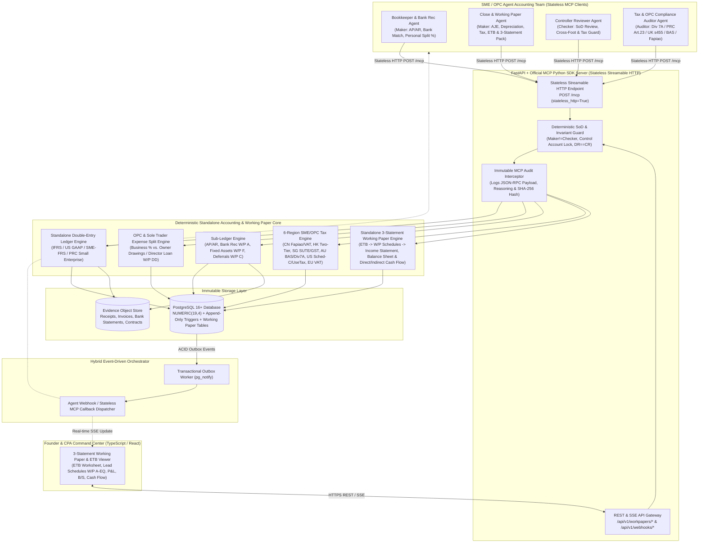
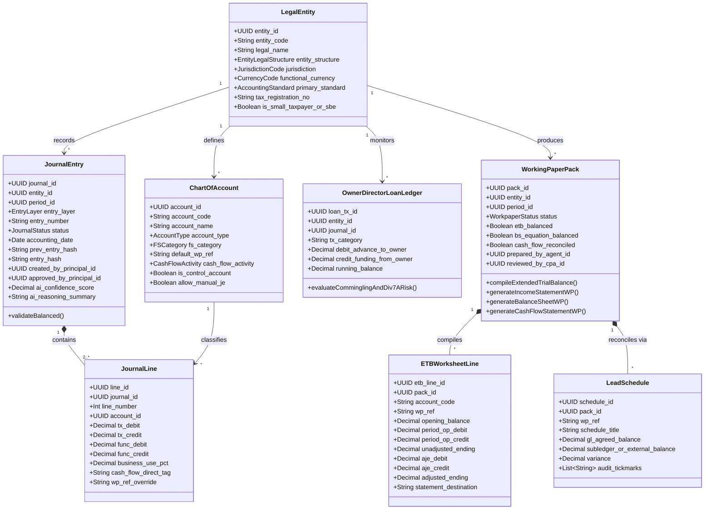
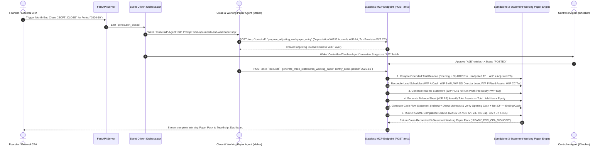
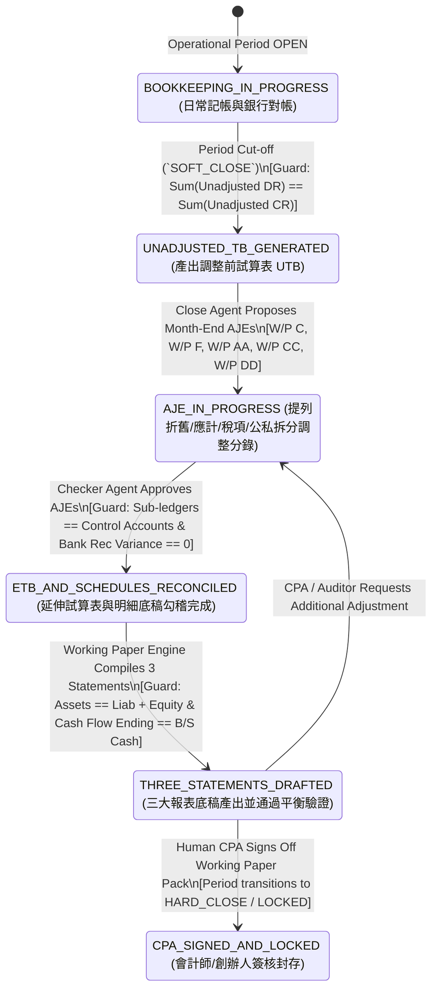

# Comprehensive UML Diagrams: Agentic Accounting System for SMEs, OPCs & Sole Proprietors

This document contains the complete Unified Modeling Language (UML) models tailored for **SMEs (中小企)**, **OPCs (One-Person Companies / 一人有限公司)**, and **Sole Proprietors (個體戶 / Sole Traders)**, centered on generating **Standalone Three Financial Statement Working Papers (`單體三大報表底稿`)**:

1. **UML Component & Hybrid Stateless MCP Architecture Diagram**
2. **UML Domain Class Diagram** (Standalone Entity, Owner/Director Loan & Commingling Guard, Extended Trial Balance `ETB`, Lead Schedules `W/P A..EQ`, and 3-Statement Working Paper Pack)
3. **UML Sequence Diagram 1**: Bookkeeping, Mixed Personal/Business Expense Apportionment (`公私混用拆分`) & Bank Feed Reconciliation
4. **UML Sequence Diagram 2**: Month-End Adjusting Entries (`AJE`), Extended Trial Balance (`ETB`) Compilation & Standalone Three Financial Statement Working Paper Generation
5. **UML State Machine Diagrams**:
   - Working Paper Pack & Three-Statement Sign-Off Lifecycle
   - Journal Entry & Maker-Checker-CPA Governance State Machine

## 1. UML Component & Hybrid MCP Architecture Diagram

## 2. UML Domain Class Diagram (Standalone SME / OPC & Working Paper Model)

## 3. UML Sequence Diagram 1: Mixed Personal/Business Expense Apportionment (`公私混用拆分`) & Bank Rec

```mermaid
sequenceDiagram
    autonumber
    participant Bank as Bank Feed / Receipt OCR
    participant API as FastAPI Ingestion
    participant DB as PostgreSQL (Ledger + Outbox)
    participant Orch as Event-Driven Orchestrator
    actor BK_Agent as Bookkeeper Agent (Maker)
    participant MCP as Stateless MCP Endpoint (POST /mcp)
    participant Split as Expense Split & Tax Engine
    actor Ctrl_Agent as Controller Agent (Checker)

    Bank->>API: Upload Receipt + Bank Line (AUD 1,100 Home Fibre & Cloud Server, incl. AUD 100 GST)
    API->>DB: Insert `bank_statement_lines` + Emit `expense_receipt.uploaded` in `outbox_events`
    DB-->>Orch: pg_notify `accounting_outbox_channel`
    Orch->>BK_Agent: Wake `Bookkeeper-Agent` with receipt & entity structure (`OPC_LIMITED` / `SOLE_PROPRIETOR`)

    BK_Agent->>MCP: POST /mcp `tools/call` `propose_expense_with_personal_split` (business_use_pct=0.70)
    MCP->>Split: Compute 70% Business vs. 30% Personal Apportionment
    Split-->>MCP: DR 6100 Cloud/Internet Expense (700.00) + DR 1420 Recoverable GST (70.00) + DR 2190 Director Loan / 3200 Drawings (330.00, 0% GST credit) / CR 1110 Bank (1,100.00)
    MCP->>DB: Save Proposal (`PENDING_CHECKER`) + Update `W/P DD` (Director Loan Schedule) + Emit `proposal.pending_checker`
    MCP-->>BK_Agent: Return Proposal ID & `W/P DD` Commingling Check

    Orch->>Ctrl_Agent: Wake `Controller-Checker-Agent`
    Ctrl_Agent->>MCP: POST /mcp `tools/call` `review_and_approve_proposal` (Verify Maker != Checker & GST apportionment)
    MCP->>DB: Seal Journal (`POSTED` + SHA-256 `entry_hash`)
```

## 4. UML Sequence Diagram 2: Month-End Adjusting Entries (`AJE`) & Standalone 3-Statement Working Paper Pack

## 5. UML State Machine: Working Paper Pack & Three-Statement Lifecycle

